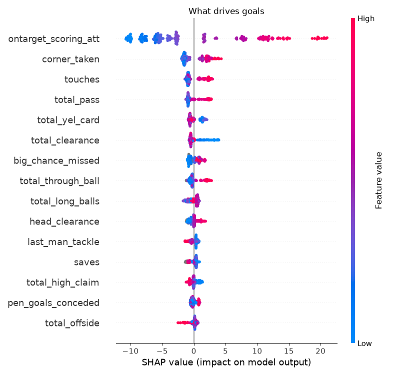
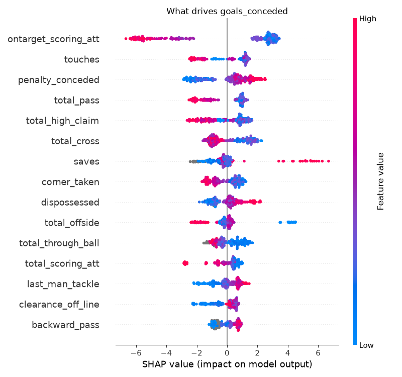
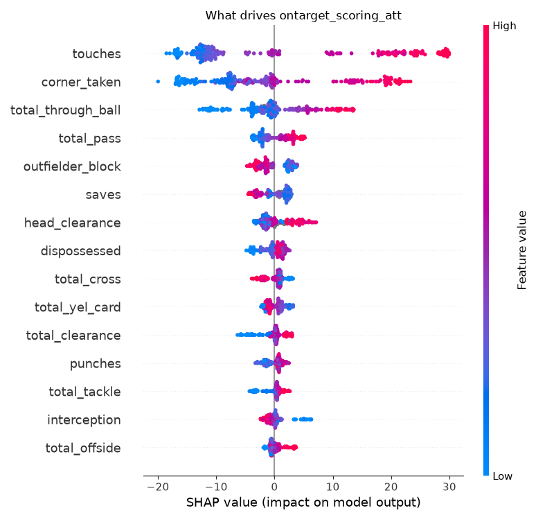
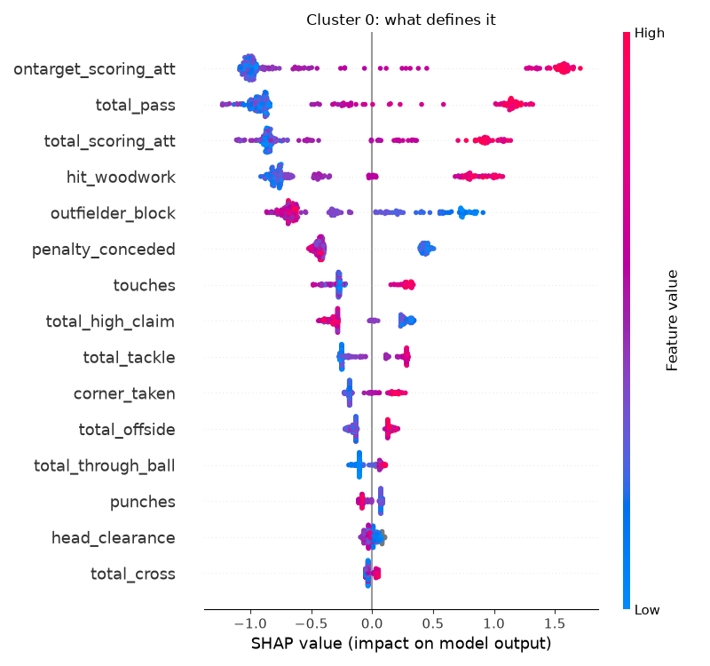

# What does it take to score in the Premier League?

A [Kedro](https://kedro.org) project that uses machine learning and [SHAP](https://shap.readthedocs.io) to find out which team statistics go with scoring goals, keeping clean sheets and getting shots on target in the Premier League.

The question: **which things a team does on the pitch (passing, touches, corners, tackles...) are most associated with scoring and not conceding?**

## Data

[`zaeemnalla/premier-league`](https://www.kaggle.com/datasets/zaeemnalla/premier-league) from Kaggle, 2006-07 to 2017-18:

| File | Contents |
|---|---|
| `stats.csv` | 240 team-seasons (20 teams x 12 seasons), about 40 stats each: goals, shots, passes, tackles, cards, clean sheets... |
| `results.csv` | About 4,560 match results (not used yet) |

Download it with:

```python
import kagglehub
path = kagglehub.dataset_download("zaeemnalla/premier-league")
```

Then copy the CSVs into `premierleague/data/01_raw/`.

## What we do

There are two Kedro pipelines in [`premierleague/`](premierleague/). Both work on team-season stats that are **z-scored within each season**, so league-wide changes in how stats are recorded don't dominate.

### 1. `drivers`: supervised models + SHAP

For each of three targets we train a LightGBM regressor and explain it with SHAP:

| Target | Question |
|---|---|
| `goals` | What makes a team score? |
| `goals_conceded` | What makes a team concede less? |
| `ontarget_scoring_att` | What creates shots on target? |

To show *how* teams get results, not just restate them, each model leaves out the outcome columns (wins, losses, clean sheets) and any stat that is a goal count. Models are cross-validated by **holding out whole seasons**.

### 2. `style_clusters`: playing styles via PCA + K-means + SHAP

1. PCA on the style stats (outcomes excluded), keeping 90% of the variance.
2. K-means on the components. The number of clusters is chosen by silhouette score.
3. For each cluster, build a binary target (`TGT_cluster_X = 1` if the team-season is in cluster X).
4. Train one XGBoost classifier per cluster on the style stats.
5. Run SHAP on each and keep the top 15 features. The sign of the feature-vs-SHAP correlation tells whether high values push towards or away from the cluster.
6. Summarise each cluster against the goals it scored and conceded.

## Findings

### Scoring



- **Shots on target dominate.** They are by far the biggest driver, well ahead of corners, touches and total passes. Cross-validated R² is **0.70**.
- Teams that score a lot also miss a lot of big chances. That reflects how many chances they create, not poor finishing.
- Heavy clearing and blocking go with scoring *less*. That is what teams do when they are pinned back.

### Conceding



- **Having the ball protects you.** Shots on target (your own), touches and passes all go with conceding fewer goals.
- Conceding penalties pushes your total up.
- Defensive actions (blocks, clearances) go with conceding *more*. This doesn't mean defending causes goals. Weak teams get stuck defending.
- This model is weaker (R² **0.43**). With only 240 rows, treat the ranking beyond the first few features as suggestive.

### Creating shots on target



- **Possession in the final third creates shots.** Touches, corners taken and through balls are the top drivers (R² **0.74**).
- Blocks and saves go with *fewer* shots on target. They show a team that is defending, not attacking.

### Playing styles

K-means found three clusters:

| Cluster | Team-seasons | Goals / season | Conceded | Defining traits | Typical teams |
|---|---|---|---|---|---|
| 0 | 56 | 73 | 36 | High shots on target, total shots, passes, hitting the woodwork. Few blocks and penalties conceded. | Liverpool, Arsenal, Chelsea |
| 1 | 76 | 49 | 51 | High passing but *fewer* shots | Everton, Tottenham, Newcastle |
| 2 | 108 | 41 | 59 | Few touches and passes, many blocks and clearances | Sunderland, Aston Villa, Stoke |



**Takeaway:** the highest-scoring style combines possession with shooting. Cluster 1 has possession too but scores about 24 fewer goals a season than cluster 0, so what separates them is shots on target, not passing volume.

## Caveats

- **Correlation, not causation.** Strong teams do everything more, so many stats move together. SHAP shows what the model uses, not what would improve a team if changed.
- **Team-season totals.** The data has no match dates or player-level information.
- **Weak clusters.** The silhouette score is only about 0.10. The clusters are better read as bands on a spectrum from dominant to defensive than as distinct styles.
- **High cluster AUCs (0.88-0.99) are expected.** The clusters are built from the same features, so the XGBoost models explain the clusters. They don't predict anything new.
- Some stats (`backward_pass`, `big_chance_missed`) are missing for 2006-2010. They are left out of the clustering, and the tree models handle the gaps.

## Running it

```bash
cd premierleague
pip install -r requirements.txt

kedro run --pipeline drivers          # models + SHAP for goals, conceded, shots on target
kedro run --pipeline style_clusters   # PCA + K-means + per-cluster SHAP
```

Outputs are written to `premierleague/data/` (ignored by git):

| Path | Contents |
|---|---|
| `08_reporting/drivers_*.csv` | Features ranked by mean abs SHAP, per target |
| `08_reporting/shap_*/` | SHAP beeswarm and importance plots |
| `08_reporting/cluster_summary.csv` | One row per cluster, with goals and heaviest feature |
| `08_reporting/cluster_top_features.csv` | Top 15 SHAP features per cluster |
| `07_model_output/` | CV metrics, SHAP values, cluster assignments |

Settings (excluded columns, model hyperparameters, number of clusters) live in [`premierleague/conf/base/parameters.yml`](premierleague/conf/base/parameters.yml).

> **Note:** the project was generated with Kedro's PySpark option. The Spark hook in `settings.py` is commented out because this analysis is pandas-only and doesn't need a JDK.

## Ideas for next steps

- Use `results.csv` to build a match outcome predictor (form, Elo ratings).
- Try more clusters (k = 4 or 5) to see whether attacking and defending styles separate.
- Add SHAP interaction values, for example touches x corners.
